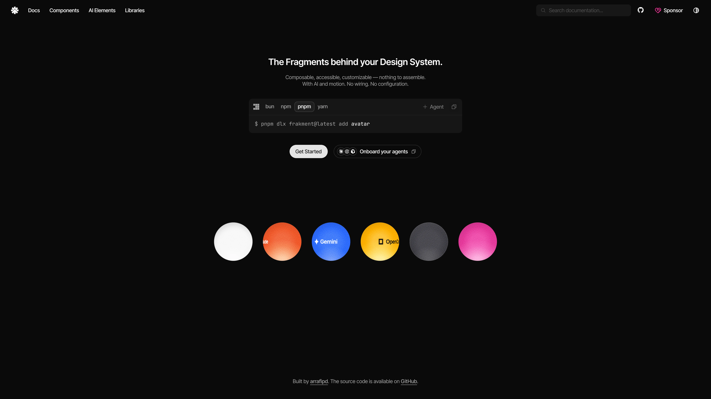

<div align="center">

<picture>
  <source media="(prefers-color-scheme: dark)" srcset="assets/logo-dark.svg">
  
</picture>

# Frakment

**The Fragments behind your Design System.**

Composable, accessible, customizable — nothing to assemble.<br/>
With AI and motion. No wiring. No configuration.

[](LICENSE)
[](https://www.npmjs.com/package/frakment)
[](https://github.com/arrafipd/frakment/actions/workflows/ci.yml)



</div>

---

**Frakment** is a component registry for React interfaces. Every component is standalone — depends only on a small set of well-known libraries, and ships as open source you can read, copy, and modify.

## Highlights

**Standalone by default** — one file per component. No wrapper, no chain, no hidden dependency tree.

**AI and motion, built in** — agent surfaces ship with AI support and motion resolved per file. Baseline primitives stay motion-ready without extra setup.

**Built for agents** — MCP server and Agent Skills let tools discover, fetch, and install components autonomously.

**Copy-paste first** — one command installs a component plus its registry dependencies.

## Components

| Category | Components |
| :--- | :--- |
| **Chat** | Bubble · Message |
| **Agent** | Trace · Chain of Thought |
| **Code** | Code Block |
| **Status** | Marker · Spinner · Pulse · Pulse Status |
| **Forms** | Input · Textarea · Field · Label · Checkbox · Switch · Select |
| **Layout** | Item · Separator · Card · Input Group · Empty |
| **Controls** | Button · Badge · Toggle · Toggle Group |
| **Identity** | Avatar |

Browse the full catalog → **[frakment.vercel.app/docs/components](https://frakment.vercel.app/docs/components)**

## Quick start

```bash
npx frakment@latest init
npx frakment@latest add bubble
```

`add` fetches the component and its registry dependencies, writes the files, and installs any missing npm packages.

## Built for agents

Frakment ships with an MCP server and Agent Skills so AI tools can discover and install components without scraping HTML.

```bash
npx -y @frakment/mcp
```

- **MCP server** → [frakment.vercel.app/docs/mcp](https://frakment.vercel.app/docs/mcp)
- **Agent Skills** → [frakment.vercel.app/docs/skills](https://frakment.vercel.app/docs/skills)
- **llms.txt** → [frakment.vercel.app/llms.txt](https://frakment.vercel.app/llms.txt)

## Documentation

| | |
| :--- | :--- |
| [**Components**](https://frakment.vercel.app/docs/components) | Baseline primitives — Button, Input, Field, Card, and more |
| [**AI Elements**](https://frakment.vercel.app/docs/ai-elements) | Chat, agent, and reasoning primitives |
| [**Installation**](https://frakment.vercel.app/docs/installation) | Setup for Next.js, Vite, Astro, and manual |
| [**Theming**](https://frakment.vercel.app/docs/theming) | CSS variables, dark mode, and tokens |
| [**MCP Server**](https://frakment.vercel.app/docs/mcp) | Registry discovery for AI tools |
| [**Changelog**](https://frakment.vercel.app/docs/changelog) | What shipped, when |

## Contributing

Contributions are welcome — typo fixes, docs, tests, translations, or new components. See [CONTRIBUTING.md](./CONTRIBUTING.md).

A merged pull request satisfies the commercial-use requirement in the license.

## License

Source-available. Free for personal and educational use. Commercial use requires one qualifying contribution — see [LICENSE](./LICENSE) Section 4.

Attribution required — see [ATTRIBUTION.md](./ATTRIBUTION.md).
