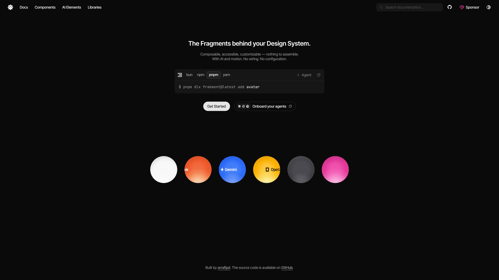

<div align="center">

<picture>
  <source
    media="(prefers-color-scheme: dark)"
    srcset="apps/web/assets/logo-dark.svg"
  >
  
</picture>

# Frakment

**Composable and accessible UI primitives for React and React Native with motion built in, customizable styling and AI-ready tooling.**

[](LICENSE)
[](https://www.npmjs.com/package/frakment)
[](https://github.com/frakment/ui/actions/workflows/ci.yml)

</div>



```bash
npx frakment@latest init
npx frakment@latest add button
```

- **43 web registry entries** across primitives, AI elements, composites, and utilities
- **3 native registry entries** for Expo and React Native
- **Accessibility checks** — selected web components have axe tests and focused keyboard/ARIA interaction tests
- **Configurable web transitions** — supported components expose CSS motion controls

Counts refer to registry entries, not individual exports; compound entries may expose multiple related components.

**[Hosted documentation](https://www.arrafi.dev/frakment/docs)** · [Docs source](./apps/web/content/docs) · **[Components](https://www.arrafi.dev/frakment/docs/components)** · **[Changelog](https://github.com/frakment/ui/releases)**

## Requirements

Node.js `>=22.18.0` · React `19` · Tailwind CSS `v4`

## Package manager

Both **npm** and **pnpm** are supported. CI runs every PR against both, and the workspace scripts detect the active package manager automatically.

```bash
npm ci && npm run build
# or
pnpm install --frozen-lockfile && pnpm build
```

See [CONTRIBUTING.md](https://github.com/frakment/ui/blob/main/CONTRIBUTING.md#package-manager) for the full policy, lockfile rules, and troubleshooting.

## Contributing

See [CONTRIBUTING.md](https://github.com/frakment/ui/blob/main/CONTRIBUTING.md).

## License

Frakment-authored code in this repository is licensed under MIT; see [LICENSE](./LICENSE).

Third-party code and dependencies retain their respective licenses; see [third-party notices](./docs/legal/THIRD_PARTY_NOTICES.md).
